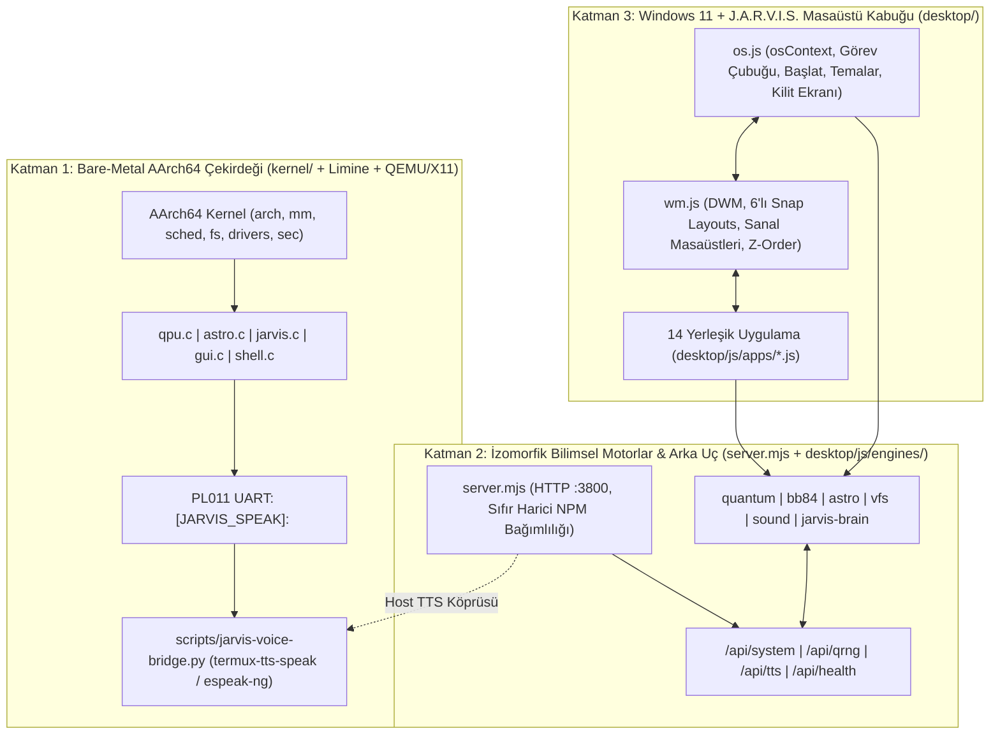

# QuantOS — Sistem Mimarisi ve Kesin Modül Sözleşmeleri

**Proje Kökü:** `/root/projects/QuantOS`  
**Tam Ad:** QuantOS (Quantro AR-GE Windows 11 + J.A.R.V.I.S. İşletim Sistemi)  
**Referans Altyapılar:** `/root/projects/Quantro-OS` (Bare-Metal AArch64 + Limine + Fluent Framebuffer) ve `/root/projects/quantro` (Quantro Kuantum & Astrofizik Bilimsel Motorları)

---

## 1. Mimari Genel Bakış ve Tasarım İlkeleri

QuantOS, donanım seviyesinde çalışan **Bare-Metal UEFI/Limine AArch64 çekirdeği** ile **Windows 11 (24H2) Fluent DWM + J.A.R.V.I.S. Sesli Yapay Zekâ masaüstü ortamını** tek bir çatı altında birleştiren 3 katmanlı hibrit bir AR-GE işletim sistemidir.



### Değişmez Mimari İlkeler
1. **Sıfır Harici NPM Bağımlılığı:** `package.json` içinde üçüncü parti `dependencies` veya `devDependencies` yer almaz; sunucu ve test altyapısı yalnızca yerleşik Node.js (`>=18/20`) modüllerini (`node:http`, `node:fs`, `node:os`, `node:crypto`, `node:child_process`, `node:test`) kullanır.
2. **İzomorfik ES Module Motorlar:** `desktop/js/engines/` altındaki 6 modül standart ES Module (`import`/`export`) yapısındadır; hem tarayıcıda hem de DOM/WebAudio/IndexedDB bulunmayan `node --test` altında çökmeden çalışır.
3. **Çekirdekte Sabit Nokta (Fixed-Point) Kuralı:** `kernel/` C kodları `-ffreestanding -nostdinc -mgeneral-regs-only` bayraklarıyla derlenir. EL1 kayan nokta yazmaç tuzaklarını önlemek ve tam sayı tabanlı `ksnprintf` ile tam uyum sağlamak için çekirdek içi kuantum (`qpu.c`) ve astrofizik (`astro.c`) hesaplamalarında **64-bit Q16.16 sabit nokta aritmetiği (`qfix_t`)** ve tam sayı ölçekli birimler (`permille ‰`, `milli`) kullanılır.
4. **Bilimsel Doğruluk:** Sözde rastgele `Math.sin` animasyon verileri yerine tam karmaşık durum vektörü $|\psi\rangle \in \mathbb{C}^{2^n}$, kısmi iz $\rho_q = \mathrm{Tr}_{\neq q}(|\psi\rangle\langle\psi|)$, CODATA 2022 sabitleri, Kerr metriği ve sayısal Simpson 1/3 integrali kullanılır.

---

## 2. Kesin Dizin Ağacı (`/root/projects/QuantOS`)

```text
/root/projects/QuantOS/
├── ARCHITECTURE.md                  # Sistem mimarisi ve kesin modül sözleşmeleri
├── README.md                        # Proje dokümantasyonu ve kullanım kılavuzu
├── LICENSE                          # MIT Lisansı
├── Makefile                         # AArch64 çekirdek, ESP, QEMU, run-jarvis, run-x11, run-vnc hedefleri
├── limine.conf                      # Limine önyükleyici yapılandırması (1280x800)
├── start-x11.sh                     # Termux:X11 + ses köprüsü + QEMU tam ekran başlatıcı
├── start-quantos.sh                 # Birleşik başlatıcı (web | x11 | qemu | kernel | test)
├── package.json                     # ESM ("type": "module"), sıfır harici bağımlılık
├── server.mjs                       # Port 3800 statik dosya + /api/{system,qrng,tts,health} sunucusu
├── bootloader/
│   ├── BOOTAA64.EFI                 # Limine UEFI AArch64 önyükleyici ikilisi
│   └── limine                       # Limine yardımcı aracı
├── scripts/
│   ├── jarvis-voice-bridge.py       # UART [JARVIS_SPEAK]: -> termux-tts-speak / espeak-ng köprüsü
│   └── verify-integrity.mjs         # Sözdizimi, gizli anahtar ve dosya bütünlük denetleyicisi
├── os-distro/                       # Katman 3: Linux Live ISO ve systemd / Wayland entegrasyon paketi
│   ├── build-iso.sh                 # Debian Live tabanlı önyüklenebilir QuantOS ISO oluşturucu
│   ├── jarvisd/jarvisd.py           # Live ISO yerel sistem telemetri ve TTS arka plan servisi (port 3801)
│   ├── systemd/jarvisd.service      # systemd servis birimi
│   └── wayland/quantos-session.desktop # Tam ekran Wayland masaüstü oturum tanımı
├── kernel/
│   ├── main.c                       # Limine rev 2 giriş noktası, alt sistem başlatma ve UART PowerShell
│   ├── arch/aarch64/
│   │   ├── boot.S                   # _start, yığın kurulumu, PSCI HVC çağrıları
│   │   ├── linker.ld                # Yüksek yarım-uzay (0xffffffff80000000) ELF bağlayıcı betiği
│   │   ├── vectors.S                # EL1 istisna vektör tablosu (VBAR_EL1, 272-bayt SPSR_EL1 çerçevesi)
│   │   ├── context.S                # Görev bağlam anahtarlama (x19-x30, sp)
│   │   ├── traps.c                  # Senkron/IRQ istisna işleyicisi
│   │   └── timer.c                  # ARM Generic Timer (CNTPCT_EL0 / CNTFRQ_EL0)
│   ├── lib/
│   │   ├── string.c                 # memset, memcpy, memmove, strcmp, strncmp, strlen, atoi vb.
│   │   ├── format.c                 # kvsnprintf, ksnprintf, u64_to_dec/hex
│   │   ├── font8x8.c                # 8x8 bitmap font tablosu
│   │   └── font8x16.c               # 8x16 bitmap font tablosu
│   ├── mm/
│   │   ├── pmm.c                    # 4 KiB fiziksel sayfa çerçevesi ayırıcı
│   │   ├── vmm.c                    # 4-seviyeli AArch64 MMU sanal bellek yöneticisi
│   │   └── heap.c                   # Dinamik çekirdek öbeği (kmalloc/kfree)
│   ├── proc/
│   │   └── proc.c                   # Preemptive görev zamanlayıcı ve bağlam anahtarlama
│   ├── fs/
│   │   ├── vfs.c                    # Çekirdek Sanal Dosya Sistemi
│   │   └── fat/fat.c                # FAT32 BPB, küme zinciri ve kök dizin okuyucusu
│   ├── drivers/
│   │   ├── uart.c                   # PL011 MMIO seri port sürücüsü (0x09000000)
│   │   ├── virtio/virtio_mmio.c     # QEMU virt VirtIO-MMIO aygıt tarayıcısı
│   │   ├── mouse.c                  # VirtIO tablet/fare sürücüsü
│   │   └── blk.c                    # VirtIO blok aygıt sürücüsü
│   ├── loader/
│   │   └── elfloader.c              # 64-bit AArch64 ELF doğrulayıcı ve yükleyici
│   ├── net/
│   │   └── net.c                    # Ethernet/ARP/IPv4/ICMP/UDP/TCP ağ yığını
│   ├── sound/
│   │   └── sound.c                  # Çekirdek ses/frekans sentez sürücüsü
│   ├── sec/
│   │   └── sec.c                    # TPM 2.0 PCR bankası, Secure Boot, VBS ve Defender
│   ├── user/
│   │   └── user.c                   # Kullanıcı, SID, rol ve oturum (SAM) yöneticisi
│   ├── wm/
│   │   ├── wm.c                     # Çekirdek pencere yöneticisi
│   │   ├── clipboard.c              # Çekirdek pano yöneticisi
│   │   └── notify.c                 # Çekirdek bildirim yöneticisi
│   ├── quantum/
│   │   └── qpu.c                    # Q16.16 sabit noktalı 4-kübit durum vektörü + BB84 QKD öz-testi
│   ├── astro/
│   │   └── astro.c                  # Schwarzschild, foton küresi, ISCO ve yörünge hızı çekirdek motoru
│   ├── jarvis/
│   │   └── jarvis.c                 # Çekirdek içi NLU komut motoru ve [JARVIS_SPEAK]: UART ses protokolü
│   ├── gfx/
│   │   ├── fb.c                     # 32-bpp Framebuffer + Acrylic/yuvarlatılmış dikdörtgen çizim motoru
│   │   └── gui.c                    # Win11 Masaüstü + J.A.R.V.I.S. HUD + Q-Lab + AstroLab pencereleri
│   └── include/                     # Çekirdek C17 başlık dosyaları (qpu.h, astro.h, jarvis.h, gui.h vb.)
├── desktop/
│   ├── index.html                   # Önyükleme -> Kilit Ekranı -> Masaüstü kabuğu giriş noktası
│   ├── manifest.webmanifest         # PWA uygulama bildirimi
│   ├── sw.js                        # Çevrimdışı önbellek servis çalışanı
│   ├── assets/                      # SVG ikonlar, 128x128 doku ve 6 duvar kağıdı varlığı
│   ├── css/
│   │   ├── quantos.css              # 4 kurumsal tema, kabuk, görev çubuğu, uçar menüler ve DWM pencere stilleri
│   │   └── apps.css                 # 14 yerleşik uygulamanın bileşen stilleri
│   └── js/
│       ├── os.js                    # osContext, önyükleme, masaüstü kabuğu ve olay veri yolu
│       ├── wm.js                    # WindowManager (DWM pencere yaşam döngüsü, 6'lı Snap, sanal masaüstü)
│       ├── engines/
│       │   ├── quantum-engine.js    # Complex, QuantumCircuit & QuantumPresets
│       │   ├── bb84-engine.js       # simulateBB84, generateQRNGBytes, fetchLiveQRNG, computeByteStats
│       │   ├── astro-engine.js      # ASTRO_CONSTANTS, blackHoleMetrics, NBodySystem, cosmologyMetrics, ligoChirpWaveform
│       │   ├── vfs.js               # VirtualFileSystem (IDB/LS/Mem + AES-256-GCM şifreleme)
│       │   ├── sound-engine.js      # SoundEngine (Web Audio sentezleyici + FFT analizör)
│       │   └── jarvis-brain.js      # JarvisBrain (TR/EN NLU + WebSpeech + /api/tts + getConfig/setConfig)
│       └── apps/
│           ├── icons.js             # 1.5px vektör SVG ikon sistemi (emoji içermez)
│           ├── registry.js          # 14 uygulamanın meta veri ve fabrika kayıt tablosu (APP_REGISTRY)
│           ├── jarvis-app.js        # [1]  appId: "jarvis"
│           ├── qlab-app.js          # [2]  appId: "qlab"
│           ├── astrolab-app.js      # [3]  appId: "astrolab"
│           ├── qvault-app.js        # [4]  appId: "qvault"
│           ├── explorer-app.js      # [5]  appId: "explorer"
│           ├── terminal-app.js      # [6]  appId: "terminal"
│           ├── code-app.js          # [7]  appId: "code"
│           ├── taskmgr-app.js       # [8]  appId: "taskmgr"
│           ├── settings-app.js      # [9]  appId: "settings"
│           ├── browser-app.js       # [10] appId: "browser"
│           ├── calculator-app.js    # [11] appId: "calculator"
│           ├── notepad-app.js       # [12] appId: "notepad"
│           ├── spectrum-app.js      # [13] appId: "spectrum"
│           └── store-app.js         # [14] appId: "store"
└── test/
    ├── quantum-bb84.test.mjs        # QuantumCircuit, Bloch kısmi iz, QASM, BB84 ve QRNG testleri
    ├── astro.test.mjs               # Schwarzschild/Kerr, NBody Verlet, ΛCDM, LIGO, Sidereal testleri
    ├── vfs-jarvis-server.test.mjs   # VFS AES-256-GCM, JarvisBrain NLU/eylem ve server.mjs API/CSP testleri
    └── desktop-apps.test.mjs        # 14 uygulama kaydı, DOM #id sözleşmesi ve ses köprüsü CLI testleri
```

---

## 3. Katman 1 — Bare-Metal UEFI/Limine AArch64 Çekirdeği Sözleşmesi

### 3.1 Derleme, Önyükleme ve Çalıştırma Hedefleri
- **`Makefile` Hedefleri:**
  - `make` / `make all`: `kernel/` altındaki tüm `.c` ve `.S` dosyalarını derleyerek `build/kernel` ELF64 imajını üretir.
  - `make esp`: `esp/EFI/BOOT/BOOTAA64.EFI`, `esp/limine.conf` ve `esp/boot/kernel` FAT dizinini hazırlar.
  - `make run`: QEMU `virt` (`cortex-a53`, `1G` RAM, `QEMU_EFI.fd`, `ramfb`, `virtio-gpu-pci,xres=1280,yres=800`, `-serial file:serial.log`) ile başlatır.
  - `make run-jarvis`: `scripts/jarvis-voice-bridge.py --log serial.log --follow` arka plan köprüsüyle birlikte QEMU'yu başlatır.
  - `make run-x11` / `make x11`: `./start-x11.sh` üzerinden Termux:X11 tam ekran grafik arayüzünü ve ses köprüsünü başlatır.
  - `make run-vnc`: `0.0.0.0:5900` VNC sunucusu üzerinden başlatır.
  - `make clean`: `build/`, `esp/`, `serial.log` ve `qmp.sock` çıktısını siler.
- **`CFLAGS`:** `-std=gnu17 -Wall -Wextra -O2 -pipe -ffreestanding -nostdinc -fno-stack-protector -fno-pie -fno-pic -mgeneral-regs-only -ffunction-sections -fdata-sections -Ikernel/include -Ikernel/arch/aarch64 -D__AARCH64__`
- **`limine.conf`:** `timeout: 0`, `graphics: yes`, `interface_resolution: 1280x800`, `protocol: limine`, `resolution: 1280x800`, `kernel_path: boot():/boot/kernel`.

### 3.2 Sabit Nokta Aritmetiği (`kernel/include/types.h`)
```c
typedef int64_t qfix_t;
#define QFIX_SHIFT      16
#define QFIX_ONE        (1LL << QFIX_SHIFT)          /* 65536 (1.0) */
#define QFIX_INV_SQRT2  46341LL                      /* round(65536 / sqrt(2)) */

static inline qfix_t qfix_from_int(int64_t x) { return x << QFIX_SHIFT; }
static inline qfix_t qfix_mul(qfix_t a, qfix_t b) { return (a * b) >> QFIX_SHIFT; }
static inline qfix_t qfix_div(qfix_t a, qfix_t b) { return (b != 0) ? ((a << QFIX_SHIFT) / b) : 0; }
void qfix_format(qfix_t val, int frac_digits, char *buf, size_t size);
```

### 3.3 Temel Çekirdek Alt Sistem İmzaları

| Alt Sistem | Dosyalar | Zorunlu C Arayüz İmzaları |
| :--- | :--- | :--- |
| **Mimari (`arch/aarch64`)** | `boot.S`, `vectors.S`, `context.S`, `traps.c`, `timer.c` | `void traps_init(void);`, `void timer_init(void);`, `uint64_t timer_ticks(void);`, `uint64_t timer_frequency(void);`, `uint64_t timer_uptime_sec(void);`, `uint64_t psci_version(void);`, `void psci_reset(void);` |
| **Bellek (`mm`)** | `pmm.c`, `vmm.c`, `heap.c` | `void pmm_init(struct limine_memmap_response *m);`, `uintptr_t pmm_alloc_page(void);`, `void pmm_free_page(uintptr_t p);`, `uint64_t pmm_get_total_memory(void);`, `uint64_t pmm_get_free_memory(void);`, `uint64_t pmm_get_used_memory(void);`, `void vmm_init(uintptr_t hhdm);`, `int vmm_map_page(uint64_t *tbl, uintptr_t va, uintptr_t pa, uint64_t flags);`, `void heap_init(uintptr_t base, size_t sz);`, `void *kmalloc(size_t sz);`, `void *kzalloc(size_t sz);`, `void kfree(void *p);`, `size_t heap_get_used(void);`, `size_t heap_get_total(void);` |
| **Zamanlayıcı (`sched`)** | `sched/sched.c` (`sched.h`) | `void sched_init(void);`, `int sched_create_task(const char *name, void (*entry)(void), int priority);`, `int sched_kill_task(int pid);`, `void sched_tick(void);`, `void sched_yield(void);`, `int sched_task_count(void);`, `const sched_task_t *sched_get_task(int idx);` |
| **Dosya Sistemi (`fs`)** | `fs/vfs.c`, `fs/fat32.c` (`vfs.h`, `fat32.h`) | `void vfs_init(void);`, `int vfs_mkdir(const char *path);`, `int vfs_write(const char *name, const char *data);`, `const char *vfs_read(const char *name);`, `int vfs_delete(const char *name);`, `void vfs_list(void);`, `void fat32_init(void);`, `int fat32_mount(void);`, `int fat32_open(const char *path);`, `int fat32_read(int fd, void *buf, uint32_t len);`, `void fat32_list_root(void);` |
| **Sürücüler (`drivers`)** | `uart.c`, `fb.c`, `virtio_mmio.c`, `mouse.c`, `keyboard.c`, `blk.c`, `elfloader.c`, `net.c`, `sound.c` | `void uart_init(uintptr_t base);`, `void uart_puts(const char *s);`, `void uart_printf(const char *fmt, ...);`, `int uart_rx_ready(void);`, `char uart_getc(void);`, `void fb_init(struct limine_framebuffer *lfb);`, `void fb_present(void);`, `void fb_draw_acrylic_panel(int x, int y, int w, int h, int r, uint32_t rgb, uint8_t alpha);`, `void mouse_init(uint64_t hhdm);`, `void mouse_poll(void);`, `void keyboard_init(uint64_t hhdm);`, `int keyboard_poll_char(void);`, `void blk_init(uint64_t hhdm);`, `int blk_read_sector(uint64_t lba, void *buf);`, `int blk_write_sector(uint64_t lba, const void *buf);`, `void elfloader_init(void);`, `int elfloader_validate(const void *elf, size_t sz);`, `int elfloader_load(const void *elf, size_t sz, uint64_t *entry_out);`, `void net_init(uint64_t hhdm);`, `void sound_init(void);`, `void sound_beep(uint32_t freq, uint32_t ms);` |
| **Güvenlik (`sec`)** | `sec/tpm2.c`, `sec/sam.c` (`tpm2.h`, `sam.h`) | `void tpm2_init(void);`, `int tpm2_pcr_extend(uint32_t pcr, const uint8_t *hash32);`, `int tpm2_get_random(uint8_t *buf, size_t len);`, `const tpm2_status_t *tpm2_get_status(void);`, `void sam_init(void);`, `int sam_authenticate(const char *user, const char *pass);`, `const char *sam_current_user(void);`, `const char *sam_current_sid(void);` |

### 3.4 Çekirdek QPU — `kernel/quantum/qpu.c` (`kernel/include/qpu.h`)
```c
#ifndef QUANTOS_QPU_H
#define QUANTOS_QPU_H

#include "types.h"

#define QPU_MAX_QUBITS 6
#define QPU_MAX_DIM    (1 << QPU_MAX_QUBITS) /* 64 durum genliği */

typedef struct { qfix_t re; qfix_t im; } qcomplex_t;

typedef struct {
    int        num_qubits;
    int        gate_count;
    qcomplex_t state[QPU_MAX_DIM];
    int        last_measurement;
} qpu_circuit_t;

typedef struct {
    int      bit_length;
    int      eavesdrop;
    int      sifted_length;
    int      error_count;
    uint32_t qber_permille;   /* 0..1000; <110 ise güvenli (QBER < %11) */
    int      secure;
    char     key_hex[33];
} qpu_bb84_report_t;

void     qpu_init(void);
void     qpu_reset(qpu_circuit_t *qc, int num_qubits);
int      qpu_h(qpu_circuit_t *qc, int qubit);
int      qpu_x(qpu_circuit_t *qc, int qubit);
int      qpu_y(qpu_circuit_t *qc, int qubit);
int      qpu_z(qpu_circuit_t *qc, int qubit);
int      qpu_s(qpu_circuit_t *qc, int qubit);
int      qpu_t(qpu_circuit_t *qc, int qubit);
int      qpu_cx(qpu_circuit_t *qc, int control, int target);
int      qpu_cz(qpu_circuit_t *qc, int control, int target);
int      qpu_swap(qpu_circuit_t *qc, int q1, int q2);
uint32_t qpu_prob_permille(const qpu_circuit_t *qc, int basis_index);
int      qpu_measure_all(qpu_circuit_t *qc, uint64_t seed);
void     qpu_preset_bell(qpu_circuit_t *qc);
void     qpu_preset_ghz(qpu_circuit_t *qc, int num_qubits);
void     qpu_preset_grover2(qpu_circuit_t *qc);
int      qpu_bb84_simulate(int length, int eavesdrop, uint64_t seed, qpu_bb84_report_t *out);
const qpu_circuit_t *qpu_get_active_circuit(void);

#endif /* QUANTOS_QPU_H */
```

### 3.5 Çekirdek Astrofizik — `kernel/astro/astro.c` (`kernel/include/astro.h`)
```c
#ifndef QUANTOS_ASTRO_H
#define QUANTOS_ASTRO_H

#include "types.h"

typedef struct {
    uint32_t mass_solar;
    uint32_t spin_permille;        /* 0..998 (a* = spin_permille / 1000) */
    uint64_t rs_meters;            /* Schwarzschild yarıçapı 2GM/c^2 */
    uint64_t r_plus_meters;        /* Kerr dış olay ufku r_+ */
    uint64_t r_photon_meters;      /* Ekvatoral prograde foton küresi */
    uint64_t r_isco_meters;        /* Prograde ISCO yarıçapı */
    uint64_t hawking_picokelvin;   /* Hawking sıcaklığı (10^-12 K) */
    uint64_t surface_gravity_ms2;  /* Yüzey kütleçekimi ivmesi */
} astro_bh_metrics_t;

typedef struct {
    uint32_t z_milli;              /* Kızıla kayma z * 1000 */
    uint32_t h0_km_s_mpc;          /* Hubble sabiti (varsayılan 67) */
    uint64_t comoving_mpc;         /* Eş-hareketli mesafe (Mpc) */
    uint64_t luminosity_mpc;       /* Parlaklık mesafesi d_L (Mpc) */
    uint64_t lookback_myr;         /* Geriye bakış süresi (Myr) */
    uint64_t universe_age_myr;     /* Evren yaşı (~13797 Myr) */
} astro_cosmo_metrics_t;

typedef struct {
    char     name[16];
    qfix_t   mass, x, y, vx, vy;
    uint32_t color_rgb;
} astro_body2d_t;

void astro_init(void);
int  astro_calc_blackhole(uint32_t mass_solar, uint32_t spin_permille, astro_bh_metrics_t *out);
int  astro_calc_cosmology(uint32_t z_milli, uint32_t h0_km_s_mpc, astro_cosmo_metrics_t *out);
void astro_orbit_reset_solar(astro_body2d_t *bodies, int *count_out);
void astro_orbit_step(astro_body2d_t *bodies, int count, qfix_t dt);
const astro_bh_metrics_t *astro_get_active_bh(void);

#endif /* QUANTOS_ASTRO_H */
```

### 3.6 Çekirdek J.A.R.V.I.S., GUI, QuantShell ve Ses Köprüsü
- **`kernel/jarvis/jarvis.c` (`kernel/include/jarvis.h`):**
  - `void jarvis_init(void);`
  - `void jarvis_speak(const char *text);` -> PL011 UART üzerinden tam olarak `[JARVIS_SPEAK]: <tek satırlık arındırılmış metin>\r\n` çerçevesini gönderir.
  - `int jarvis_process(const char *command, jarvis_reply_t *out);` -> NLU niyetini (`bell`, `ghz`, `bb84`, `blackhole`, `sysinfo`, `qlab`, `astrolab`, `security`) ayrıştırır, ilgili çekirdek alt sistemini tetikler ve `jarvis_speak(out->reply)` çağırır.
- **`scripts/jarvis-voice-bridge.py`:**
  - CLI seçenekleri: `--log serial.log`, `--follow`, `--once`, `--stdin`, `--lang tr-TR`.
  - `[JARVIS_SPEAK]:\s*(.+)` satırlarını yakalar; sırasıyla `termux-tts-speak` -> `espeak-ng` -> `espeak` ikililerini kabuksuz (`subprocess.run([...])`) çağırır; ses ikilisi yoksa çökmeden `[JARVIS-TTS-FALLBACK]` çıktısı üretir.
- **`kernel/gfx/gui.c` (`kernel/include/gui.h`):**
  - Windows 11 görev çubuğu + Başlat menüsü + J.A.R.V.I.S. HUD Arc Reactor + **Q-Lab penceresi** + **AstroLab penceresi** + Terminal/Explorer/TaskMgr/Settings/Calc pencereleri (`GUI_APP_NONE=0`, `GUI_APP_JARVIS=1`, `GUI_APP_QLAB=2`, `GUI_APP_ASTROLAB=3`, `GUI_APP_TERMINAL=4`, `GUI_APP_EXPLORER=5`, `GUI_APP_TASKMGR=6`, `GUI_APP_SETTINGS=7`, `GUI_APP_CALC=8`).
  - İmzalar: `gui_init()`, `gui_boot_splash()`, `gui_redraw()`, `gui_tick(uint64_t uptime_sec)`, `gui_open_app(int app_id)`, `gui_handle_mouse(int x, int y, int buttons)`, `gui_handle_key(char c)`.
- **`kernel/shell/shell.c` (`kernel/include/shell.h`):**
  - `shell_init()`, `shell_execute_line(const char *line, char *out_buf, size_t out_size)`, `shell_poll_uart()`.
  - Zorunlu komutlar: `help`, `jarvis`, `speak`, `qpu`, `bb84`, `blackhole`, `cosmo`, `sysinfo`, `mem`, `pmm`, `heap`, `ps`, `ls`, `cat`, `tpm`, `whoami`, `open`, `clear`, `reboot`.

---

## 4. Katman 2 — Bilimsel Motorlar, Sesli J.A.R.V.I.S. Beyni ve Arka Uç Sözleşmesi

### 4.1 `package.json` ve `server.mjs` (Port 3800)
- **`package.json`:**
  ```json
  {
    "name": "quantos",
    "version": "1.0.0",
    "private": true,
    "type": "module",
    "scripts": {
      "start": "node server.mjs",
      "test": "node --test test/*.test.mjs",
      "check": "node scripts/verify-integrity.mjs && node --test test/*.test.mjs",
      "kernel": "make all",
      "x11": "./start-x11.sh"
    }
  }
  ```
- **`server.mjs` Export Sözleşmesi:**
  - `export function createQuantOSServer(options = {})` -> `http.Server` döndürür (`../` dizin geçişi saldırılarına karşı `400/403` korumalı statik `desktop/` sunucusu + REST API).
  - `export async function startServer(port = Number(process.env.PORT) || 3800, host = "0.0.0.0")`.
  - Doğrudan `node server.mjs` olarak çalıştırıldığında `3800` portunu dinler.

### 4.2 REST API Uçları ve JSON Şemaları

| Yöntem & Uç | Sorgu / Gövde | Dönüş Şeması (`200 OK`, `application/json; charset=utf-8`) |
| :--- | :--- | :--- |
| **`GET /api/health`** | Yok | `{ ok: true, service: "QuantOS", version: "1.0.0", uptimeSec: number, port: number, timestamp: string }` |
| **`GET /api/system`** | Yok | `{ ok: true, hostname: string, platform: string, arch: string, kernel: string, cpuModel: string, cores: number, loadAvg: [number, number, number], cpuUsagePercent: number, totalMem: number, freeMem: number, usedMem: number, memory: { total: number, free: number, used: number, totalBytes: number, freeBytes: number, usedBytes: number, usedPercent: number }, uptimeSec: number, ttsEngine: "termux-tts-speak" \| "espeak-ng" \| "espeak" \| "none", provenance: "linux-procfs" \| "node-os", timestamp: string }` |
| **`GET /api/qrng`** | `?length=32` veya `?count=32` (`1..1024`, varsayılan `32`) | `{ ok: true, length: number, bytes: number[], hex: string, bits: string, shannonEntropy: number, source: "anu-qrng" \| "node-crypto-csprng", isTrueQuantum: boolean, latencyMs: number, timestamp: string }` *(2500 ms zaman aşımı ile ANU QRNG dener; çevrimdışı/hata durumunda `node:crypto.randomBytes` fallback ve kaynak damgası uygular)* |
| **`POST /api/tts`** | `{ text: string, lang?: "tr-TR" \| "en-US", rate?: number }` | `{ ok: true, spokenOnHost: boolean, engine: "termux-tts-speak" \| "espeak-ng" \| "espeak" \| "none", textLength: number, lang: string }` *(`execFile` ile kabuksuz güvenli çağrı; geçersiz/boş metinde `400` `{ ok: false, error: "INVALID_TEXT" }`)* |

### 4.3 İzomorfik Motor Sözleşmeleri (`desktop/js/engines/`)

#### 4.3.1 `desktop/js/engines/quantum-engine.js`
- **Exportlar:** `export { Complex, GATES, QuantumCircuit, Presets, Presets as QuantumPresets }`
- **Kübit Sıralaması:** $|q_0 q_1 \dots q_{n-1}\rangle$ ($q_0$ MSB), $1 \le n \le 6$ (üst sınır $8$).
- **`QuantumCircuit` Sınıfı:**
  - `constructor(numQubits = 2)`
  - Kapılar (`this` döndürür): `h(q)`, `x(q)`, `y(q)`, `z(q)`, `s(q)`, `t(q)`, `rx(q, theta)`, `ry(q, theta)`, `rz(q, theta)`, `cx(control, target)`, `cz(control, target)`, `swap(q1, q2)`
  - `reset()` -> kapıları ve durumu sıfırlar (`this`).
  - `run()` -> $|0\dots0\rangle$ durumundan kapı dizisini uygular ve `this` döndürür (`probabilities()`, `blochVector()`, `sample()` çağrıları gerektiğinde `run()`'ı otomatik garanti eder).
  - `probabilities()` -> `number[]` ($2^n$ elemanlı, $\sum P_i = 1$).
  - `probabilityMap()` -> `Record<string, number>`.
  - `blochVector(qubit)` -> indirgenmiş yoğunluk matrisi $\rho_q = \mathrm{Tr}_{\neq q}(|\psi\rangle\langle\psi|)$ üzerinden `{ x, y, z, theta, phi, purity }` (dolanık Bell kübiti için `purity = 0.5`, `x = y = z = 0`).
  - `sample(shots = 1024, seed = null)` -> `{ counts: Record<string, number>, shots, mostLikely, seed }` (`seed` verildiğinde deterministik PRNG).
  - `toQASM()` -> `OPENQASM 2.0; include "qelib1.inc"; qreg q[n]; creg c[n]; ...`.
- **`Presets` (`QuantumPresets`):** `bell()`, `ghz(n = 3)`, `grover2(marked = "11")`, `teleportation()`, `superdense(bits = "11")`.

#### 4.3.2 `desktop/js/engines/bb84-engine.js`
- **Exportlar:** `export { simulateBB84, generateQRNGBytes, computeByteStats }`
- **`simulateBB84({ length = 64, eavesdrop = false, interceptRate = 1.0, channelNoise = 0.0, seed = null } = {})`:**
  - Dönüş: `{ length, eavesdrop, aliceBits, aliceBases, eveBases, eveBits, bobBases, bobBits, matchedIndices, siftedAlice, siftedBob, siftedAliceKey, siftedBobKey, finalKeyHex, siftedLength, errorCount, qber, threshold: 0.11, secure }` (`secure === (qber < 0.11 && siftedLength > 0)`).
- **`generateQRNGBytes(length = 32)`:** `Uint8Array` kriptografik entropi üretir (`globalThis.crypto.getRandomValues` / `node:crypto`).
- **`computeByteStats(bytes)`:** `{ length, mean, shannonEntropy, zeroBitRatio, oneBitRatio, chiSquare }`.

#### 4.3.3 `desktop/js/engines/astro-engine.js`
- **Exportlar:** `export { CONSTANTS, CONSTANTS as ASTRO_CONSTANTS, blackHoleMetrics, NBodySystem, Presets, cosmologyMetrics, ligoChirpWaveform, siderealAndJulian, shiftWavelength }`
- **`CONSTANTS` (`ASTRO_CONSTANTS`):** CODATA 2022 sabitleri (`c: 299792458`, `G: 6.67430e-11`, `h: 6.62607015e-34`, `hbar: 1.054571817e-34`, `kB: 1.380649e-23`, `sigmaSB: 5.670374419e-8`, `M_sun: 1.98847e30`, `L_sun: 3.828e26`, `AU: 1.495978707e11`, `pc: 3.0856775814913673e16`, `Mpc: 3.0856775814913673e22`, `ly: 9.4607304725808e15`, `julianYearSec: 31557600`).
- **`blackHoleMetrics(massSolar, spin = 0)`:**
  - Dönüş (hem `Km` hem `Meters` alanlarını içerir): `{ massSolar, massKg, spin, rgMeters, schwarzschildRadiusKm, schwarzschildRadiusMeters, eventHorizonRadiusKm, eventHorizonPlusMeters, eventHorizonMinusMeters, photonSphereKm, photonSphereProgradeMeters, photonSphereRetrogradeMeters, iscoProgradeKm, iscoProgradeMeters, surfaceGravityMs2, hawkingTempK, hawkingTempKelvin, hawkingPowerWatts, evaporationTimeSec }`.
- **`NBodySystem` ve `Presets` (`NBodySystem.Presets = Presets`):**
  - `new NBodySystem(bodies, { G, softening, integrator: "verlet" | "rk4" })`
  - Metotlar: `step(dt, substeps = 1)`, `advance(steps, dt)`, `totalEnergy()` (`{ kinetic, potential, total }`), `angularMomentum()`, `getSnapshot()`, `reset()`.
  - Hazır sistemler: `Presets.solarInner()`, `Presets.binaryPulsar()`, `Presets.figureEight()`.
- **`cosmologyMetrics(zOrOpts, H0 = 67.4, OmegaM = 0.315, OmegaL = 0.685)`:**
  - Hem konumsal `(z, H0, OmegaM, OmegaL)` hem nesne `({ z, H0, OmegaM, OmegaL })` çağrısını destekler; bileşik Simpson 1/3 integrali ($N = 1000$) kullanır.
  - Dönüş: `{ z, H0, OmegaM, OmegaL, OmegaK, hubbleParameterAtZ, comovingDistanceMpc, luminosityDistanceMpc, angularDiameterDistanceMpc, distanceModulusMag, lookbackTimeGyr, ageAtRedshiftGyr, universeAgeNowGyr, universeAgeGyr }`.
- **`ligoChirpWaveform({ m1Solar = 36, m2Solar = 29, durationSec = 0.5, sampleRate = 2048, distanceMpc = 410 } = {})`:**
  - Dönüş: `{ times, strain, hPlus, hCross, frequencies, chirpMassSolar, totalMassSolar, fISCOHz, peakStrain, sampleRate }`.
- **`siderealAndJulian(date = new Date(), longitudeDeg = 28.9784)`:**
  - Dönüş: `{ iso, julianDate, jd, mjd, gmstHours, gmstFormatted, lmstHours, lmstFormatted, earthOrbitalSpeedKmS, longitudeDeg }`.
- **`shiftWavelength(restNm, z)`:** `restNm * (1 + z)`.

#### 4.3.4 `desktop/js/engines/vfs.js`
- **Exportlar:** `export { VirtualFileSystem, defaultVFS }`
- **Öntanımlı Dizinler:** `C:/QuantOS`, `C:/QuantOS/Vault`, `C:/Users/Quantro/Desktop`, `C:/Users/Quantro/Documents`, `C:/Users/Quantro/Research`, `C:/Users/Quantro/Circuits`.
- **Mimari:** `await vfs.init()` çağrısı `IndexedDB` -> `localStorage` -> bellek içi `Map` katmanından ağacı belleğe yükler; ardından dosya işlemleri senkron bellek ağacı üzerinde anında çalışır ve arka planda kalıcı depoya yazılır:
  - Senkron CRUD & Sorgu: `exists(path)`, `list(dirPath)`, `read(filePath)`, `write(filePath, content, meta)`, `mkdir(dirPath)`, `remove(targetPath)`, `rename(oldPath, newPath)`, `copy(srcPath, dstPath)`, `stat(targetPath)`, `search(query, rootPath = "C:/")`.
  - Asenkron Kriptografi (`WebCrypto` PBKDF2-SHA256 + AES-256-GCM): `await encryptFile(filePath, passphrase)`, `await decryptFile(filePath, passphrase)`, `await encryptPayload(plaintext, passphrase)`, `await decryptPayload(envelope, passphrase)`.

#### 4.3.5 `desktop/js/engines/sound-engine.js`
- **Exportlar:** `export { SoundEngine, soundEngine }`
- **Metotlar:** `init()`, `setVolume(v)`, `getVolume()`, `setMuted(bool)`, `isMuted()`, `playBoot()`, `playClick()`, `playSnap()`, `playJarvisWake()`, `playJarvisAck()`, `playQuantumCollapse()`, `playNotification()`, `playChirp(samples, sampleRate)`, `getFrequencyData(uint8Array)`.

#### 4.3.6 `desktop/js/engines/jarvis-brain.js`
- **Exportlar:** `export { JarvisVoiceIO, JarvisBrain }`
- **`JarvisVoiceIO`:** `SpeechRecognition` (`tr-TR` / `en-US`, `"jarvis"` uyandırma kelimesi) + `speechSynthesis` + `/api/tts` arka uç ses köprüsü fallback (`startContinuousListening`, `stopListening`, `listenOnce`, `speak`, `stopSpeaking`, `getCapabilities`).
- **`JarvisBrain`:**
  - `constructor({ osContext = null, voiceIO = null, llmConfig = null } = {})`
  - `async processCommand(text, contextOrOptions = {})` *(İkinci argüman `openApp` içeriyorsa `osContext` olarak, `{ speak, osContext }` biçimindeyse seçenek nesnesi olarak işlenir; varsayılan olarak `this.osContext` kullanılır.)*
  - Dönüş şeması:
    `{ reply: string, action: { type: string, payload: object } | null, data: object | null, provenance: string }`.

---

## 5. Katman 3 — Windows 11 + J.A.R.V.I.S. Masaüstü Kabuğu ve 14 Uygulama Sözleşmesi

### 5.1 `osContext` Küresel Arayüz Sözleşmesi (`desktop/js/os.js`)
```js
const osContext = {
  openApp(appId, args = {}),          // Pencereyi açar/odaklar, winId döndürür
  closeApp(winId),                    // Pencereyi kapatır ve destroy() kancasını çalıştırır
  minimizeAll(),                      // Tüm pencereleri simge durumuna küçültür (Win+D)
  snapWindows(mode),                  // "left-right" | "quad" | "focus-three" | "grid-6" | "cascade" | "maximize"
  setTheme(themeId),                  // "ink-copper" | "jarvis-holo" | "win11-mica" | "vellum-light"
  setWallpaper(wpId),                 // "quantum-bloom" | "arc-reactor" | "kerr-horizon" | "deep-field"
  switchDesktop(idx),                 // 0 (Komuta) | 1 (Kuantum AR-GE) | 2 (Astrofizik Gözlemevi)
  notify(title, body, category),      // "system" | "jarvis" | "quantum" | "security" | "astro"
  vfs,                                // VirtualFileSystem örneği
  sound,                              // SoundEngine örneği
  jarvis,                             // JarvisBrain örneği
  voice,                              // JarvisVoiceIO örneği
  wm,                                 // WindowManager örneği
  getSystemStatus(),                  // Anlık sistem/pencere/bellek/çekirdek durumu
  on(event, handler),                 // Kabuk olay aboneliği
  emit(event, payload)                // Kabuk olay yayını
};
```

### 5.2 Uygulama Modülü Yaşam Döngüsü Sözleşmesi (`desktop/js/apps/<appId>.js`)
Her uygulama modülü `appMeta` ve `mount(containerEl, osContext, args)` sembollerini (veya eşdeğer uygulama tanım nesnesini) export eder; pencere kapatıldığında tüm `requestAnimationFrame` ve `setInterval` kaynaklarını temizleyen `destroy()` fonksiyonunu döndürür.

### 5.3 14 Uygulamanın Kesin `appId` Kayıt Tablosu (`desktop/js/apps/registry.js`)

| # | Kesin `appId` | Modül Yolu | Pencere Başlığı | Sorumluluk ve Bağlı Motorlar |
| :-: | :--- | :--- | :--- | :--- |
| 1 | `jarvis` | `desktop/js/apps/jarvis.js` | J.A.R.V.I.S. Komuta Merkezi | Arc-Reactor ses çekirdeği, canlı transkript, TR/EN sesli/yazılı komutlar, makrolar, LLM ayarı (`jarvis-brain`, `sound-engine`, `/api/tts`) |
| 2 | `qlab` | `desktop/js/apps/qlab.js` | Quantro Q-Lab | 1–6 kübit devre editörü, kısmi iz Bloch küresi, durum vektörü, 1024-shot histogram, OpenQASM 2.0 (`quantum-engine`, `vfs`) |
| 3 | `astrolab` | `desktop/js/apps/astrolab.js` | Quantro AstroLab | Kerr kara delik mercekleme, Velocity-Verlet N-cisim simülatörü, $\Lambda$CDM kozmoloji, LIGO sesli cıvıltı (`astro-engine`, `sound-engine`) |
| 4 | `qvault` | `desktop/js/apps/qvault.js` | Q-Vault (BB84 & QRNG) | BB84 QKD simülasyonu ve QBER güvenlik analizi, `/api/qrng` kuantum entropi, AES-256-GCM dosya kasası (`bb84-engine`, `vfs`) |
| 5 | `explorer` | `desktop/js/apps/explorer.js` | Dosya Gezgini | `C:/QuantOS` & `C:/Users/Quantro/*` üzerinde tam CRUD, arama ve uzantıya göre uygulama açma (`vfs`) |
| 6 | `terminal` | `desktop/js/apps/terminal.js` | QuantShell Terminal | Çok sekmeli CLI: `qsim`/`qpu`, `bb84`, `qrng`, `blackhole`, `cosmo`, `jarvis`, `sysinfo`, `neofetch`, `ls`, `cat`, `open` |
| 7 | `code` | `desktop/js/apps/code.js` | QuantCode Studio | Çok sekmeli kod/QASM/Markdown düzenleyici, JS çalıştırıcı ve Q-Lab devre aktarımı (`vfs`, `quantum-engine`) |
| 8 | `taskmgr` | `desktop/js/apps/taskmgr.js` | Görev Yöneticisi | Açık pencere/süreç yönetimi, FPS, `/api/system` Linux çekirdek yükü/RAM ve QPU telemetri grafikleri |
| 9 | `settings` | `desktop/js/apps/settings.js` | Sistem Ayarları | 4 kurumsal tema, duvar kağıtları, Ses/TTS motoru, QRNG/Ağ, Güvenlik, J.A.R.V.I.S. AI ve VFS sıfırlama |
| 10 | `browser` | `desktop/js/apps/browser.js` | Quantro Edge Tarayıcı | Sekmeli Quantro AR-GE bilgi portalı, kuantum/astrofizik sözlüğü, CODATA 2022 başvuru kartları |
| 11 | `calculator` | `desktop/js/apps/calculator.js` | Bilimsel Hesap Makinesi | Standart/Bilimsel mod, CODATA 2022 fizik sabitleri ($c, h, \hbar, G, k_B, M_\odot$) ve birim dönüştürücü |
| 12 | `notepad` | `desktop/js/apps/notepad.js` | Not Defteri & AR-GE Günlüğü | Çok sekmeli Markdown/metin düzenleyici, okuma görünümü ve VFS kaydı (`vfs`) |
| 13 | `spectrum` | `desktop/js/apps/spectrum.js` | Spektrum & Sinyal Stüdyosu | Astronomik element tayf çizgileri (`H, He, Na, Ca II, Fe, O III`), Doppler $z$-kayması (`shiftWavelength`) ve ses FFT görselleştiricisi |
| 14 | `store` | `desktop/js/apps/store.js` | Quantro Mağaza | 14 yerleşik uygulamanın kataloğu, Başlat/Görev Çubuğu sabitleme ve örnek AR-GE veri paketleri |

---

## 6. Doğrulama Kapıları

1. **Çekirdek Derleme & Önyükleme:** `make clean && make && make esp` hatasız tamamlanmalı; `build/kernel` ve `esp/boot/kernel` üretilmeli; `scripts/jarvis-voice-bridge.py` seri `[JARVIS_SPEAK]:` satırlarını işlemelidir.
2. **Birim ve Entegrasyon Testleri:** `npm test` (`node --test test/*.test.mjs`) ve `npm run check` (`node scripts/verify-integrity.mjs`) %100 başarıyla geçmelidir.
3. **Masaüstü Çalışma Zamanı:** `node server.mjs` (Port `3800`) altında 14 uygulamanın tamamı, pencere kenetleme düzenleri, temalar ve Türkçe/İngilizce J.A.R.V.I.S. sesli komutları eksiksiz çalışmalıdır.
